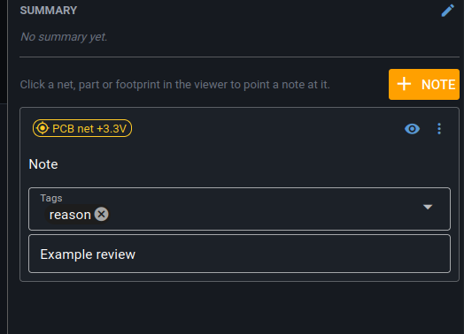

## Note
<!-- kigit-note {"id": "7e90f7d4", "anchor": {"tab": "pcb", "kind": "net", "name": "+3.3V", "seen": {"old": "9df463c8be19fd45b971f1d3e045aa6907ac47ba", "new": "0ead0a878ec6e95d3d77f64ff0104924ea3bb773", "side": "new"}}, "tags": ["reason"]} -->

Example review
